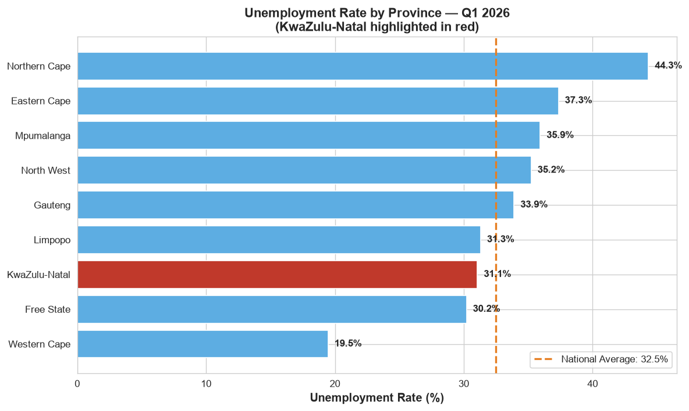
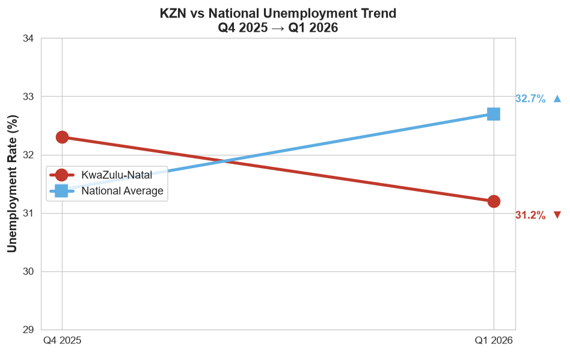
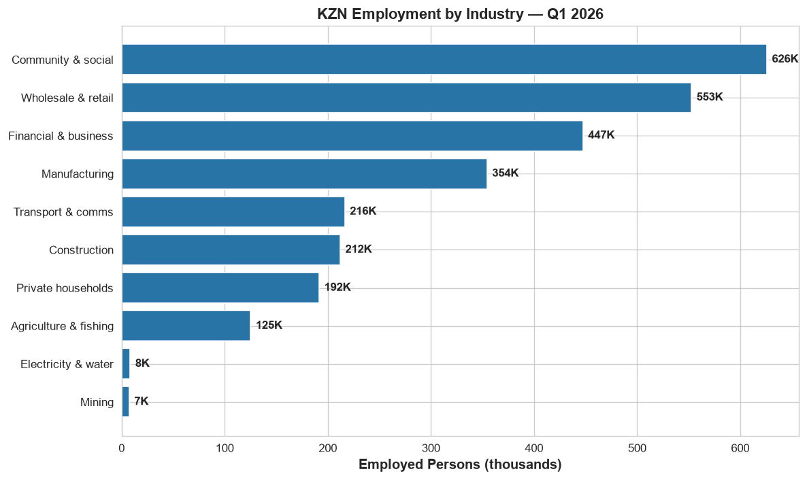
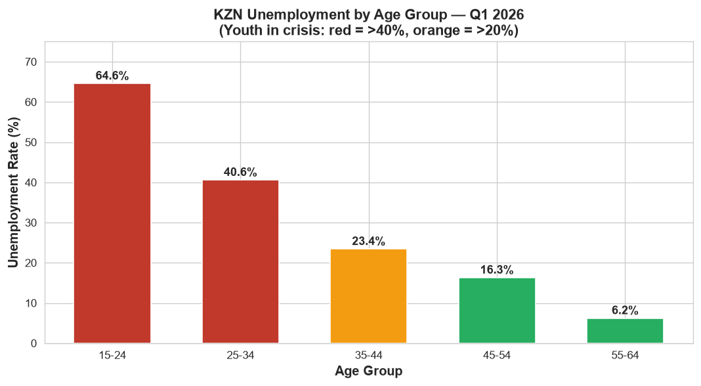

# The KZN Anomaly: Why Did KwaZulu-Natal's Unemployment Rate Decrease in Q1 2026?

## Project Overview

While South Africa's national unemployment rate rose from 31.4% to 32.7% between Q4 2025 and Q1 2026, **KwaZulu-Natal was the only province to record a decrease** (from 32.3% to 31.2%). This project investigates the drivers behind this anomaly using the Quarterly Labour Force Survey (QLFS) Q1 2026 microdata from Statistics South Africa.

## Research Question

Which industries, education levels, and age groups contributed to KZN's unique employment growth in Q1 2026?

## Key Findings

| Metric | Value |
|---|---|
| KZN Unemployment Rate (Q1 2026) | **31.1%** |
| National Unemployment Rate | 32.5% |
| Employed KZN residents (weighted) | 2,740,409 |
| Unemployed KZN residents (weighted) | 1,234,348 |
| Youth (15-24) unemployment | **64.6%** |
| Youth (25-34) unemployment | 40.6% |

**Three factors explain the KZN anomaly:**

1. **Formal-sector dominance** — 69% of employed KZN residents work in the formal sector, which proved more resilient than informal or agricultural work.
2. **Service-sector concentration** — Community & social services (625K) and wholesale/retail trade (553K) are KZN's top industries.
3. **Youth crisis hidden by aggregate** — the province's overall rate is low because its large 35-54 population is stably employed, but youth unemployment remains severe.

## 📊 Charts

### Unemployment Rate by Province (Q1 2026)
KwaZulu-Natal highlighted in red — the only province below the national average trend.

### KZN vs National Unemployment Trend
While the national rate rose, KZN's rate fell — the anomaly this project investigates.

### KZN Employment by Industry
The province's employment base is concentrated in community services, retail, and financial services.

### KZN Unemployment by Age Group
The aggregate number hides a youth crisis: 64.6% of 15-24 year olds are unemployed.

## Data Source

Quarterly Labour Force Survey (QLFS) Q1 2026, Statistics South Africa, distributed via [DataFirst (UCT)](https://www.datafirst.uct.ac.za/).

**Citation:** Statistics South Africa. *Quarterly Labour Force Survey 2026: Quarter 1* [dataset]. Version 1. Pretoria: Statistics South Africa [producer], 2026. Cape Town: DataFirst [distributor], 2026. DOI: https://doi.org/10.25828/twqp-bh07

## Methodology

- **Data:** 62,819 survey responses × 201 variables
- **Tools:** Python (pandas, matplotlib, seaborn)
- **Weights:** All results use the survey's population weight to produce statistically representative estimates
- **Verification:** National weighted unemployment rate (32.5%) closely matches Stats SA's official figure (32.7%), confirming methodology

## Project Structure
kzn-unemployment-anomaly/
├── data/
│ ├── raw/ # Original QLFS dataset (not committed to Git)
│ ├── external/ # Supplementary data
│ └── processed/ # Cleaned data
├── notebooks/
│ └── 01_data_loading.ipynb
├── src/ # Reusable Python functions
├── outputs/
│ └── figures/ # Analysis charts
└── reports/ # Written analysis

## Author

Amahle Shezi — Final-year ICT student, Durban University of Technology